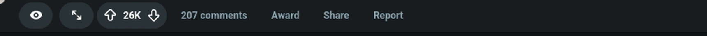
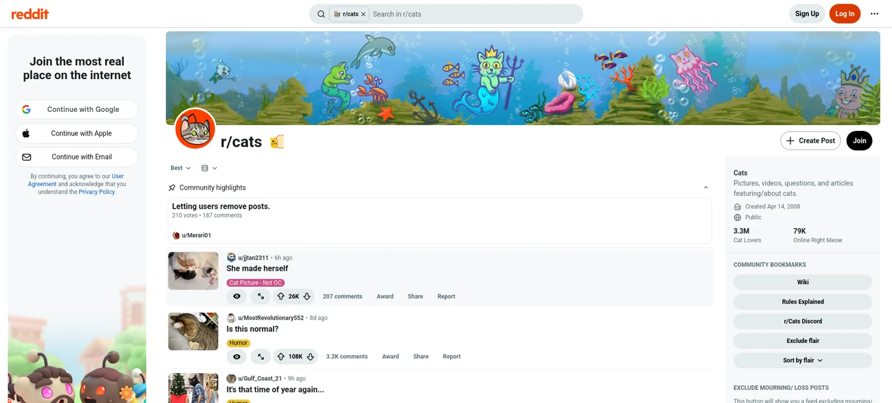
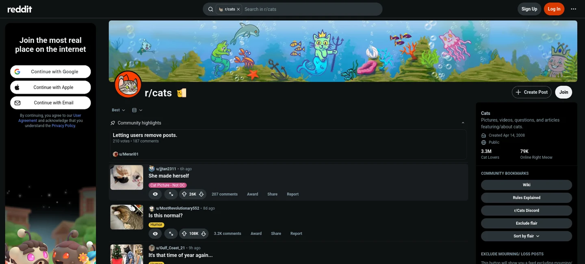
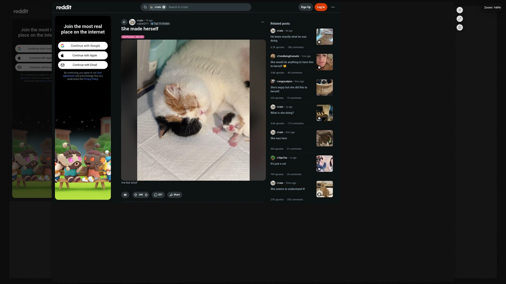

# Glance Button

A [Sine](https://github.com/CosmoCreeper/Sine) mod for Zen Browser. On Reddit, it adds an **Open in Glance** button as the first action in each post's action row — before Expand in compact view and before the vote pill in card view. One click opens the post in Glance. No Alt, Ctrl, or Shift.

The button is built with the expand chevron's `rpl-cab` pill classes in the darker `button-secondary` variant, matching the other post actions in both light and dark themes. Card and compact views expose the row through the post's open shadow root, so the button can sit before every action instead of being limited to Reddit's overflow slot. Clicking opens the post's permalink; the Glance open animation starts from the button.

It does nothing if Glance is disabled in Zen settings, or if a Glance is already open (Zen's own guard).

## Screenshots

### First action in compact view

The eye precedes Expand, votes, comments, and every other action.



### Light and dark themes





### Opened in Glance

Clicking the eye opens that post's permalink in Zen's Glance panel.



## Scope

- Works on the current Reddit layout (`shreddit-post`), on feed, subreddit, and comment pages, including posts loaded by infinite scroll and client-side navigation.
- Old Reddit (`old.reddit.com`) has a different DOM and is not supported.
- Ads are skipped.

## Install with Sine

Local and GitHub mods run script only when Sine is allowed to load external JavaScript. In **Settings → Sine**, enable external JS (`sine.allow-unsafe-js` in `about:config`). Then restart Zen if Sine asks you to.

### From GitHub

1. Open **Settings → Sine**.
2. Paste this repository's GitHub URL into the field for adding your own mod. A subdirectory install also works: `owner/repo/tree/branch` if `theme.json` is not at the repo root.
3. Add it, enable **Glance Button**, and restart if Sine asks.

Sine can update the mod only after `homepage` in `theme.json` is the GitHub URL above. Set that before you publish.

### Copy the folder

1. Copy this directory to `chrome/sine-mods/glance-button` inside your Zen profile (`about:profiles` → **Root Directory** → `chrome/sine-mods`). The folder name must be `glance-button`. A symlink to your checkout works too, for development.
2. In `chrome/sine-mods/mods.json`, add this entry inside the root object. Add a comma so the JSON stays valid.

```json
"glance-button": {
  "id": "glance-button",
  "name": "Glance Button",
  "description": "Adds an Open in Glance button as the first action in Reddit post rows. No modifier key.",
  "author": "rteobaldo",
  "version": "1.3.2",
  "createdAt": "2026-11-15",
  "updatedAt": "2026-11-20",
  "tags": ["zen", "glance", "reddit"],
  "fork": ["zen"],
  "scripts": {
    "glance-button.uc.js": {
      "include": ["chrome://browser/content/browser.xhtml*"]
    }
  },
  "readme": "README.md",
  "enabled": true
}
```

3. Restart Zen, or reload mods from the Sine page, then open Reddit.

Sine's **Import** button does not install this folder. It reads a JSON export and downloads each mod from its GitHub `homepage`. Use the GitHub field or the copy above. The built-in **Zen Mods** page cannot load this mod at all: it only applies CSS and never runs scripts.

Turning the mod off in Sine does not remove the buttons until Zen restarts. That is Sine's normal behavior for a script that cannot unload itself.

## Files

| File | Role |
| --- | --- |
| `theme.json` | Sine manifest |
| `glance-button.uc.js` | Registers the content actor once per session |
| `actors/GlanceButtonChild.sys.mjs` | Injects the button into Reddit post rows |
| `actors/GlanceButtonParent.sys.mjs` | Opens Glance when the button is clicked |

## How Glance is triggered

The child actor runs in the page process. For each post it finds the action row exposed through the post's open shadow root and inserts the button before the row's first child. In compact view that puts it before Expand; in card view it puts it before the vote pill. Older or partially hydrated layouts use the overflow-menu slot, whitespace slot, or repost button as fallbacks. A document-level capture listener matches clicks through `composedPath()`, so the same handler works in light DOM and open shadow roots. It sends `GlanceButton:Open` with the post URL and the button's rectangle. The parent actor validates the sender (Reddit only) and the URL (`http`/`https`), then calls:

```js
gZenGlanceManager.openGlance({
  url,
  triggeringPrincipal: Services.scriptSecurityManager.getSystemPrincipal(),
  clientX, clientY, width, height,
});
```

## License

[MPL-2.0](LICENSE) — modifications to this mod's files must stay under the same license; files you add alongside it can be licensed however you like.
